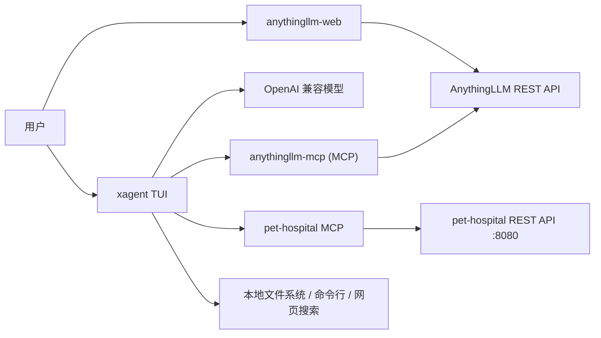

# FAN-053 · AI Agent 与 MCP 项目合集

本仓库包含课程期末项目的四个部分：宠物医院 MCP、AnythingLLM MCP、AnythingLLM 网页控制台、定制终端 Agent（XAgent）。
每个子项目都可以独立运行，顶层文档给出模块关系、配置与验证步骤。

## 项目地图

```text
.
├── pet-hospital/                 # 维度 A：宠物医院 MCP
│   ├── mcp/                      #   FastMCP stdio server（+ 测试）
│   ├── windows/                  #   宠物医院 Windows 发行包说明与接口文档
│   └── docs/                     #   开发提示词
├── anythingllm-mcp/              # 维度 B：AnythingLLM MCP Server（+ 测试）
├── anythingllm-web/              # 维度 C：AnythingLLM 网页控制台
├── agent/
│   ├── practice01/               #   练习：多轮问答 / getDate 工具
│   ├── practice02/               #   练习：文件操作 / 闰年工具
│   └── xagent/                   # 维度 D：定制 Agent（core + tui + tests）
├── AGENTS.md                     # XAgent 长期规则（启动时注入）
├── opencode.json                 # opencode MCP 注册示例
└── README.md
```

## 模块关系



- `pet-hospital/mcp`：把宠物医院 REST API 封装为 MCP 工具。
- `anythingllm-mcp`：把 AnythingLLM 的工作区、文档、对话、检索封装为 MCP 工具。
- `anythingllm-web`：浏览器直接调用 AnythingLLM API 的单页控制台。
- `agent/xagent`：通用终端 Agent，作为 MCP 客户端接入上述 server，并支持 Skill、AGENTS.md、会话与上下文压缩。

## 环境依赖

| 模块 | 依赖 |
| --- | --- |
| 宠物医院服务 | Windows 发行包 `pethospital.exe`（无需 Go/数据库运行时） |
| pet-hospital MCP | Python 3.10+，`mcp[cli]`、`httpx` |
| anythingllm-mcp | Python 3.10+，`mcp`、`httpx`、`pydantic` |
| anythingllm-web | 任意静态服务器；现代浏览器 |
| xagent | Python 3.10+，`openai`、`textual`、`mcp`、`httpx` |

## 配置与密钥

- 所有真实密钥只通过环境变量或本地 `.env` 注入，不入库。
- 配置模板：
  - `agent/xagent/config.example.ini`
  - `anythingllm-mcp/.env.example`
  - `pet-hospital/mcp` 使用 `PET_HOSPITAL_URL` 环境变量
- `config.ini` 中的密钥字段保持为空；`.gitignore` 排除 `.env`、`.agents/`、缓存、数据库和二进制文件。

## 分步启动

### 1. 宠物医院 MCP

```bash
# 终端 1：启动宠物医院服务（Windows 发行包）
cd pet-hospital/windows
pethospital.exe

# 终端 2：启动 MCP Server
cd pet-hospital/mcp
python -m pip install -e ".[test]"
python main.py
```

详见 [pet-hospital/mcp/README.md](pet-hospital/mcp/README.md)。

### 2. AnythingLLM MCP

```bash
cd anythingllm-mcp
python -m pip install -r requirements.txt
copy .env.example .env
# 编辑 .env：ANYTHINGLLM_API_KEY=...
python server.py
```

详见 [anythingllm-mcp/README.md](anythingllm-mcp/README.md)。

### 3. AnythingLLM 网页控制台

```bash
cd anythingllm-web
python -m http.server 5500
# 浏览器打开 http://localhost:5500/
```

页面中输入 API 地址与 Key 后连接。详见 [anythingllm-web/README.md](anythingllm-web/README.md)。

### 4. XAgent

```bash
cd agent/xagent
python -m pip install -r requirements.txt
copy config.example.ini config.ini
# 编辑 config.ini 的 [llm] 段
python main.py
```

详见 [agent/xagent/README.md](agent/xagent/README.md)。

## 在 opencode 中注册 MCP

`opencode.json` 已给出相对路径示例：

```json
{
  "mcp": {
    "pet-hospital": {
      "type": "local",
      "command": ["python", "pet-hospital/mcp/main.py"],
      "environment": {"PYTHONUTF8": "1"},
      "enabled": true
    },
    "anythingllm": {
      "type": "local",
      "command": ["python", "anythingllm-mcp/server.py"],
      "environment": {"PYTHONUTF8": "1"},
      "enabled": true
    }
  }
}
```

AnythingLLM 的密钥建议写入 `anythingllm-mcp/.env`，不要写进 `opencode.json`。

## 验证清单

| 检查 | 命令 / 操作 | 期望 |
| --- | --- | --- |
| 宠物医院服务 | 浏览器打开 `http://127.0.0.1:8080/` | 网页界面可访问 |
| pet-hospital MCP | `cd pet-hospital/mcp && python -m pytest -q` | 全部通过 |
| AnythingLLM MCP | `cd anythingllm-mcp && python -m pytest -q` | 全部通过 |
| AnythingLLM 网页 | 上传文档并提问 | 有加载/成功/失败提示 |
| XAgent 核心 | `cd agent/xagent && python -m pytest -q` | 全部通过 |
| XAgent 启动 | `python main.py` | TUI 打开，输入 `exit` 退出 |

## 架构与设计要点

- **契约优先**：所有工具都有 JSON Schema 参数、稳定返回结构和统一错误信封。
- **分层**：XAgent 的 `core/` 不依赖 Textual；界面只消费 `AgentEvent`。
- **渐进加载**：Skill 启动时只注入名称与描述，正文按需 `loadSkill`。
- **MCP 容错**：连接超时、调用超时、失败降级、状态可见，不阻塞主流程。
- **安全**：危险路径保护、不覆盖创建、编码检测、路径穿越拦截、密钥不进前端/仓库。

## 常见问题

**Q：AnythingLLM API 返回 403 No valid api key found？**
A：在 AnythingLLM 的 Settings → Developer API 创建 Key，写入 `anythingllm-mcp/.env`。

**Q：网页控制台报 CORS 错误？**
A：浏览器直接请求 AnythingLLM 时，需要 AnythingLLM 允许该来源；可用本地静态服务器或在前面加反向代理。

**Q：XAgent 提示未配置 api_key？**
A：编辑 `agent/xagent/config.ini` 的 `[llm] api_key`，或设置 `XAGENT_API_KEY`。

**Q：搜索工具提示缺少 API Key？**
A：设置 `XAGENT_SEARCH_API_KEY`（默认使用 Tavily），或在 `config.ini` 的 `[tools] search_api_key` 填写。

**Q：终端中文乱码？**
A：先执行 `chcp 65001`，或设置 `$env:PYTHONIOENCODING = "utf-8"`。

## 许可

`pet-hospital/windows/LICENSE` 为第三方发行包许可；其余代码用于课程学习。
