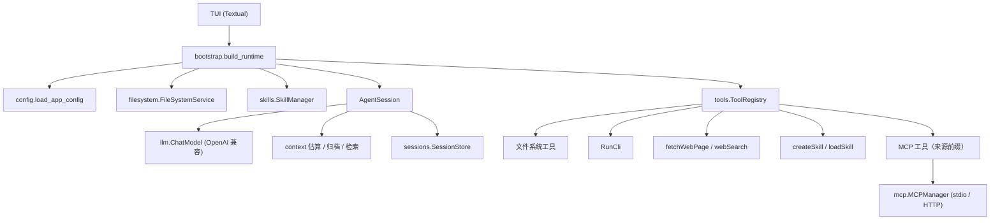

# XAgent · 终端文件操作 Agent

一个基于 **OpenAI 兼容接口（Function Calling / Tools）** 的终端 Agent。
核心（`core/`）与界面（`tui/`）分离，核心可被 TUI、Web 或桌面端复用。

## 功能

- 多轮对话 + 工具调用闭环：解析 `tool_calls` → 真实执行 → 回填 `tool` 消息 → 继续推理
- 最大工具轮次保护（`[agent] max_tool_rounds`）
- 十类文件/目录操作：取当前目录、列目录、判断类型、读文件、创建文件、编辑/追加、建目录、删目录、删文件、重命名
- 网页读取 `fetchWebPage` 与搜索 `webSearch`（搜索服务 API 可配置）
- 闰年判断 `isLeapYear`；命令行执行 `RunCli`（带超时与输出截断）
- Skill 机制：创建、发现、按需加载，启动时只注入名称与描述（渐进加载）
- MCP 客户端：读取 `.mcp.json`，支持 stdio 与 Streamable HTTP，工具并入可调用集合并标记来源
- `AGENTS.md` 长期规则：启动时读取并注入一次，缺失不报错，文件名可配置
- 会话持久化、恢复、上下文压缩与归档检索（`recallContext`）
- Textual TUI：斜杠命令、MCP 侧栏、上下文占用、压缩前后对比

## 架构



## 目录结构

```text
agent/xagent/
├── main.py                 # 入口：启动 TUI
├── config.ini              # 本地配置（api_key 留空）
├── config.example.ini      # 配置模板
├── requirements.txt
├── requirements-dev.txt
├── .mcp.json               # MCP Server 配置示例
├── core/
│   ├── agent.py            # 对话与工具调用主循环、压缩
│   ├── bootstrap.py        # 依赖装配
│   ├── config.py           # 配置读取与默认值
│   ├── context.py          # Token 估算、归档、检索
│   ├── sessions.py         # 会话 JSONL 持久化
│   ├── skills.py           # Skill 发现 / 创建 / 加载
│   ├── filesystem/         # 文件系统业务层
│   ├── llm/                # LLM 抽象与 OpenAI 兼容实现
│   ├── mcp/                # MCP 客户端、配置、工具注册
│   └── tools/              # 工具声明与实现
├── tui/                    # Textual 界面
├── examples/skills/demo/   # 示例 Skill（复制到 .agents/skills 后生效）
└── tests/                  # pytest 单元测试
```

## 安装与运行

要求 Python 3.10+。

```bash
cd agent/xagent
python -m pip install -r requirements.txt
copy config.example.ini config.ini
# 编辑 config.ini：填写 [llm] api_key / base_url / model
python main.py
```

配置也可以走环境变量：`XAGENT_API_KEY`、`XAGENT_BASE_URL`、`XAGENT_MODEL`、`XAGENT_CONTEXT_WINDOW`、`XAGENT_SEARCH_API_KEY`。

## 配置矩阵

| 配置项 | 说明 | 默认 |
| --- | --- | --- |
| `[llm] api_key` | 模型密钥（也可用 `XAGENT_API_KEY`） | 必填 |
| `[llm] base_url` | OpenAI 兼容地址 | 必填 |
| `[llm] model` | 模型名 | 必填 |
| `[llm] context_window` | 上下文窗口；不填显示“默认” | 131072 |
| `[agent] max_tool_rounds` | 单轮最大工具调用轮次 | 8 |
| `[agent] agents_md_file` | 长期规则文件名 | `AGENTS.md` |
| `[context] warning_ratio` | 触发压缩提示的占用比例 | 0.6 |
| `[sessions] dir` | 会话目录 | `.agents/sessions` |
| `[tools] cli_timeout` | 命令行超时（秒） | 30 |
| `[tools] web_timeout` | 网页/搜索超时（秒） | 20 |
| `[tools] search_api_url` | 搜索服务 API | Tavily |
| `[tools] search_api_key` | 搜索引擎密钥（建议用环境变量） | 空 |
| `[mcp] connect_timeout` | MCP 连接超时 | 30 |

## TUI 命令

| 命令 | 作用 |
| --- | --- |
| `/help` | 查看命令 |
| `/new` | 新建会话（自动保存当前会话） |
| `/resume` | 恢复历史会话 |
| `/save` | 保存当前会话 |
| `/compact` | 压缩上下文并归档原文 |
| `/status` | 查看会话、上下文、MCP 状态 |
| `/mcp` | 查看 MCP Server 与工具 |
| `/quit` | 保存并退出 |
| `exit` | 退出 |

## 工具语义

| 语义 | 工具 |
| --- | --- |
| 获取当前工作目录 | `getCurrentDirectory` |
| 列出目录 | `listDirectory` |
| 判断文件类型 | `getFileType` |
| 读取文本文件（截断） | `readFile` |
| 创建文件（不覆盖） | `createFile` |
| 编辑/追加/替换 | `editFile` |
| 创建目录（递归） | `createDirectory` |
| 删除目录（非空） | `deleteDirectory` |
| 删除文件 | `deleteFile` |
| 重命名文件/目录 | `renameItem` |
| 执行命令行 | `RunCli` |
| 闰年判断 | `isLeapYear` |
| 读取网页 | `fetchWebPage` |
| 网络搜索 | `webSearch` |
| 创建 Skill | `createSkill` |
| 加载 Skill | `loadSkill` |
| 检索压缩归档 | `recallContext` |

## Skill 机制

1. 启动时扫描 `<workspace>/.agents/skills/*/SKILL.md`，只读取 YAML frontmatter 的 `name` 与 `description`。
2. 系统提示只注入技能名称和描述，不注入正文（渐进加载）。
3. 模型需要时调用 `loadSkill` 读取正文或附件；附件路径必须位于该 Skill 目录内。
4. `createSkill` 会校验名称、拒绝覆盖，并生成带 frontmatter 的 `SKILL.md`。

示例：

```bash
mkdir -p .agents/skills
cp -r examples/skills/demo .agents/skills/demo
```

## MCP 接入

`.mcp.json` 示例：

```json
{
  "mcpServers": {
    "filesystem": {
      "type": "stdio",
      "command": "npx",
      "args": ["-y", "@modelcontextprotocol/server-filesystem", "."],
      "cwd": "."
    },
    "remote": {
      "type": "streamable_http",
      "url": "https://example.com/mcp",
      "headers": {"Authorization": "Bearer ${MCP_TOKEN}"}
    }
  }
}
```

- 支持 `${VAR}` / `$VAR` 环境变量展开。
- 外部工具名统一加 `mcp__<server>__` 前缀，description 标记来源。
- 连接失败不会阻塞主流程，TUI 侧栏和 `/mcp` 可见状态。

## AGENTS.md

在项目根目录放置 `AGENTS.md`（或通过 `[agent] agents_md_file` 改名）。启动时读取一次并作为用户消息注入，长度受 `[tools] max_text_file_bytes` 限制；文件不存在时静默跳过。恢复历史会话时不会重复注入。

## 安全边界

- 删除/重命名禁止操作磁盘根目录、当前工作目录及其上级目录。
- `createFile` 使用独占创建，不覆盖已有文件。
- 文本读写前检测编码，拒绝二进制文件；读取有字符上限。
- `RunCli` 不经过 Shell，参数以数组传递，带超时与输出截断。
- Skill 附件读取限制在 Skill 目录内，拒绝路径穿越。
- MCP 配置与 `.env`、会话/上下文目录均在 `.gitignore` 中。

## 测试

```bash
cd agent/xagent
python -m pip install -r requirements-dev.txt
python -m pytest -q
```

测试覆盖：闰年规则、十类文件操作与危险路径保护、Skill 创建/发现/加载/拒绝覆盖、上下文归档检索、工具调用闭环、网页解析与搜索错误分支。

## 已知限制

- 无流式模型输出；TUI 以事件为单位更新。
- 搜索默认使用 Tavily，需自备 API Key。
- 未提供 Web 端；核心已与 UI 解耦，可按 `AgentEvent` 复用。
